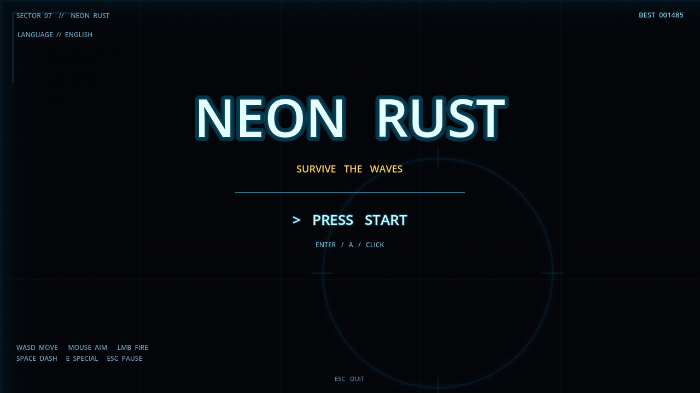
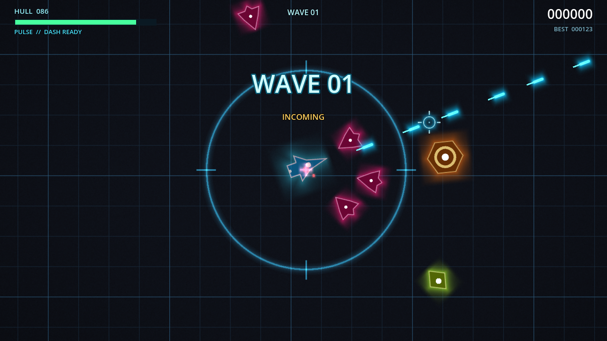
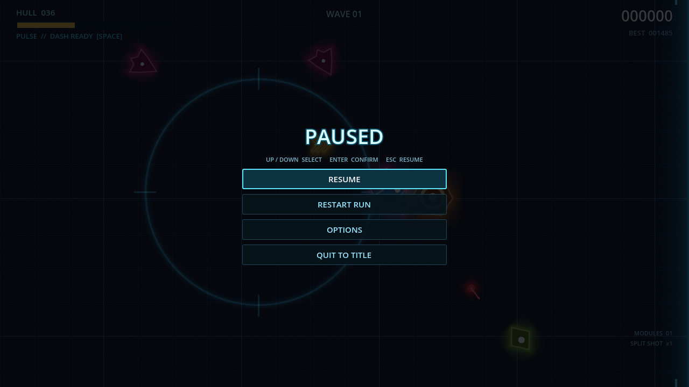
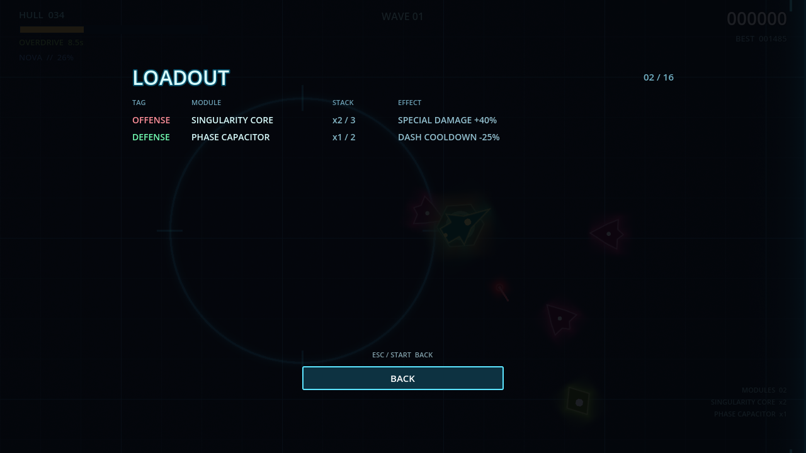
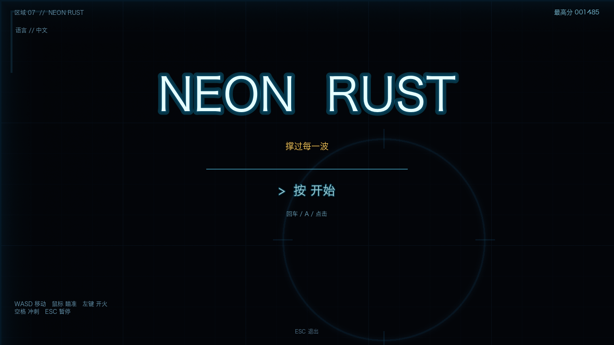
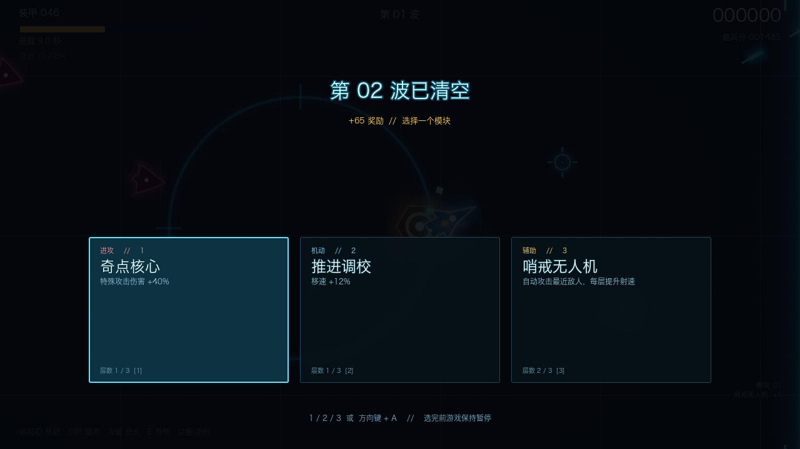
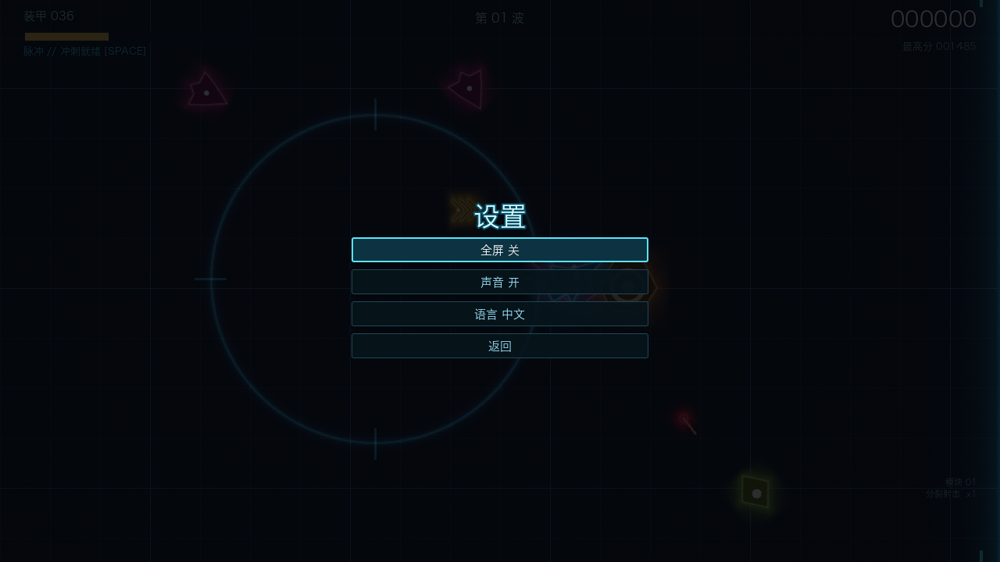
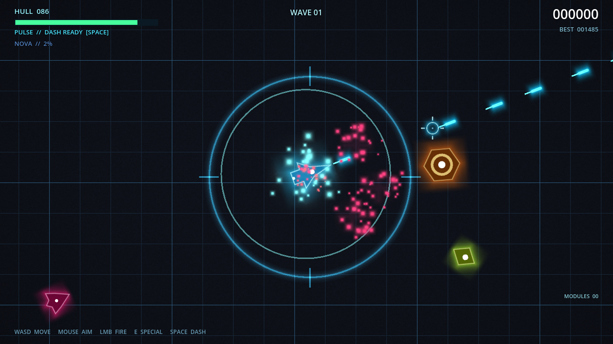
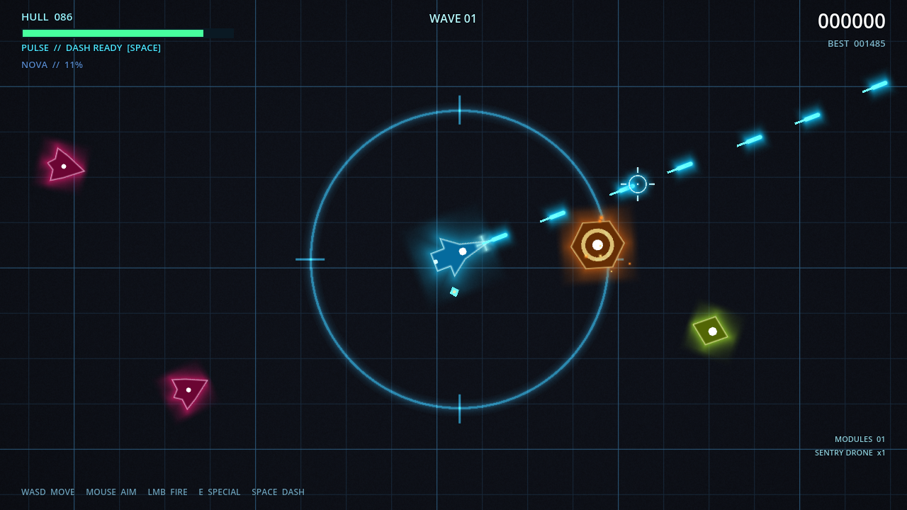
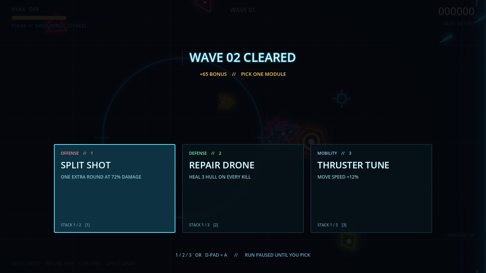

# Neon Rust / 霓虹锈蚀

俯视角双摇杆射击（Twin-stick shooter），Godot 4.7 / Forward+ / 2D 渲染，1280×720。
你驾驶一台霓虹涂装的拦截机，在一片锈蚀的废弃竞技场里撑过一波接一波的无人机群。

**当前版本已改成中路兵线模式**：只有一条中路，兵从上方沿兵线走下来打你的世界之树；英雄是 `小黑`（寒霜射手），自动索敌、自动开火。左侧仍是原来的竞技场玩法底子，只是敌人不再从四面围上来。





## 中路兵线 / 世界之树

- **一条中路**：`x = 800`，兵从上沿（`y = 110`）出现，沿兵线走到世界之树（`800, 858`）。只有你走进 250px 内，兵才会停下开打；否则它只管往前推。
- **数值一律按 DotA1 原表**：原始数据在 `modules/heroes/data/dota1/*.json`，代码里落到 `CreepCatalog`（`modules/enemies/data/`）与 `HeroCatalog`（`modules/heroes/data/`）。
- **世界之树**：`4250` 血（DotA1 远古守护者）。兵走到树前后**不再消失**，站在原地按自己的攻击间隔一直啃树，所以漏兵是持续掉血。树血量归零整局结束——真正的失败条件是丢树，而不是你被打掉。
- **兵线没有等待期**：一波清空后立刻开下一波；每波 `3 近战 + 1 远程`，每 7 波加一台投石车，每 15 波按 DotA1 的 7:30 升级周期涨血涨攻。
- **护甲**：`Armor.reduction(a) = 0.06a / (1 + 0.06a)`，对小兵、英雄、子弹统一生效（2 甲 ≈ 减伤 10.7%）。
- **小黑（寒霜射手）**：射程 `625`、攻击 `44-55`（每发在区间内随机）、间隔 `1.7s`、移速 `300`、`473` 血、`1` 甲，冰箭命中后减速 45% 持续 1.5 秒。**不需要瞄准也不需要按键**：射程内最近的兵会被自动锁定并开火，射程外一枪不发。
- 英雄数值全部在 `modules/heroes/data/hero_catalog.gd` 的 `HeroDef` 里，加第二个英雄只加一个分支 + 两组文案。
- 相机缩到 `0.85`，把整条兵线和树一起装进 1280×720，分辨率保持不变。

## 英雄成长（DotA1 口径，全自动）

杀小兵 = 拿钱 + 拿经验，剩下的全自动，玩家不用开商店也不用点技能。

- **赏金 / 经验**：近战 43 金 / 62 经验，远程 48 / 41，投石车 73 / 88（`modules/heroes/data/dota1/creeps.json`）。
- **经验曲线**：DotA1 标准 200 / 200 / 240 / 320 / 400 …，25 级封顶（`HeroProgress.XP_TABLE`）。
- **自动买装备**：开局 603 金，立刻买掉最便宜的装备；之后每次击杀只要钱够就自动补下一件，按价格从低到高：敏捷便鞋 450 → 速度之靴 500 → 急速手套 500 → 攻击之爪 500 → 锁子甲 550 → 短棍 900 → 板甲 1400 → 秘银锤 1600 → 精气之球 2100 → 水晶剑 2150 → 大炮 5150 → 蝴蝶 6000 → 撒旦之邪力 6150。属性折成本作有的五项：伤害、攻速、护甲、生命、移速。
- **自动升级被动**：每升 1 级得 1 点，固定加到当前等级最低的被动上：
  - 冰霜箭（每级 +15% 减速，上限 4 级）
  - 精准光环（每级 +8% 伤害）
  - 射手天赋（每级 +1 护甲 / +4% 攻速）
- 所有数值都折在 `PlayerUnit.refresh_stats()` 一处：基础英雄表 + 装备 + 被动 = 生效属性，重复调用不会叠乘（有测试守着）。
- 底部 DotA 式状态栏实时显示：头像、等级、绿色血条、蓝色经验条、金币、6 格装备、3 个被动技能（含等级点）。

## 操作（Steam Deck / 键盘）

| 动作 | Steam Deck | 键盘 |
|---|---|---|
| 移动 | 左摇杆 | WASD |
| 射箭 | **X** | **X** / 鼠标左键 |
| 推推棒 | **A** | **Q** |
| 特殊（奇点脉冲） | Y | E |
| 冲刺 | B | 空格 |
| 暂停 / 返回 | START / BACK | Esc / R |

- **射箭会定身**：按下 X 之后 `ROOT_TIME = 0.42s` 内英雄不能移动（DotA1 的攻击前摇），弓会拉满再放箭。自动攻击（技能被动）不受此限制。
- **推推棒**：沿当前朝向瞬间推 300px，20 秒冷却，结束时有一道拖影；键盘上 A 已经被移动占用，所以用 Q。

## 画面

- 地面全部是 `_draw` 画出来的：草地 + 土路中路 + 横穿的河道 + 路边的石头灌木 + 围着地图的树林（`modules/lanes/components/lane_visual.gd`，固定随机种子，每局长得一样）。
- 英雄和三种小兵也都是代码画的：戴兜帽的弓箭手（拉弓会跟着定身进度动）、持棒的近战兵、带兜帽的远程兵、投石车（`hero_art.gd` / `creep_art.gd`）。
- 小兵头顶有 DotA 式血条，颜色按血量分段变黄变红（`CreepHealthBar`，top-level，不跟着身体转）。
- 箭是实体箭头：细杆 + 箭头 + 尾羽，飞行中有一段"抬起再落下"的假弧线，冰霜箭是淡蓝色。

> 平衡实测：见 `tests/lane_probe.tscn`（`--fixed-fps 60` 跑），会每 5 秒打印一次小兵血量 / 英雄血量 / 已射击数。当前纯 DotA1 数值 + 只有英雄一方，第 1 波 4 个兵在 30 秒左右就能把 473 血的小黑打死，而清完 4 个兵需要约 70 秒——可守性不足，下一步要补我方小兵。


## 运行

```bash
# 直接用编辑器：用 Godot 4.7 打开本目录，F5
open -a Godot /Users/huhaixiao/github/neon-rust

# 或者命令行
/Applications/Godot.app/Contents/MacOS/Godot --path /Users/huhaixiao/github/neon-rust
```

启动后先停在首页（标题 / BEST / 操作说明），按 `Enter`、鼠标左键或手柄 `A` 才开始一局；`Esc` 在首页是退出。

首次打开会自动导入 `modules/*/assets/` 下的 PNG/WAV（已随工程附带 `.import`，通常无需等待）。

## 操作

| 动作 | 键盘 / 鼠标 | 手柄 |
| --- | --- | --- |
| 移动（左摇杆） | `W` `A` `S` `D` / 方向键 | 左摇杆 `JOY_AXIS_LEFT_*` |
| 攻击（自动） | 不用按，射程内自动开火 | 同左 |
| 特殊攻击 | `E` / 鼠标右键 | `Y` |
| 冲刺 | `Space` | `B` / `LB` |
| 暂停 | `Esc` | `START` / `BACK`（左右两个菜单键都行） |
| 重开 | `R` / `Enter` | `A` |
| 首页：开始 | `Enter` / 鼠标左键 | `A` |
| 首页：退出 | `Esc` | — |
| 结算后：回首页 | `Esc` | `START` / `BACK` |
| 静音 | `M` | — |
| 全屏 | `F11` | — |

`auto_aim` 关掉时（`PlayerUnit.auto_aim = false`）会退回原来的双摇杆手动瞄准：鼠标或右摇杆控方向、按住左键 / `X` 开火。中路版本默认开着自动攻击，准星也会隐藏。

HUD 会检测是否接了手柄：接了就把提示切成手柄说法（`X FIRE` / `Y SPECIAL` / `B DASH` / `START OR ESC TO RESUME` / `A REDEPLOY / START TITLE`），没接就显示键鼠说法。插拔手柄会即时切换。

右摇杆松开后不会把准星弹回鼠标位置：游戏会记住松开前的指向，直到你真正移动鼠标才重新交给鼠标。

键位在 `modules/global/autoload/input_setup.gd` 里用代码注册（运行时写入 InputMap），改键只改这一处；若你在项目设置里手写过同名 action，代码会尊重你的设置。

## 暂停菜单与选项



`Esc` / 手柄 `START`·`BACK` 暂停后是一张可点击、也能用方向键 / 十字键选的列表：

| 按钮 | 作用 |
| --- | --- |
| `RESUME` | 继续这一局 |
| `RESTART RUN` | 立刻重开（不用先死；暂停态按 `R` 同效） |
| `OPTIONS` | 全屏 / 静音 / 语言开关，`Esc` 返回上一级 |
| `MODULES` | 本局已选模块清单：方向、名称、层数 / 上限、当前效果 |
| `QUIT TO TITLE` | 直接退回首页 |

打开菜单时焦点自动落在 `RESUME`，手柄上按 `A` 就是继续；菜单里的按键与 `stage.gd` 的热键共用同一套实现（全屏 / 静音都收敛到 `Game` 自动加载）。

`OPTIONS` 里的 `MODULES` 行会打开本局装配页，按取得顺序列出所有已选模块：方向用颜色区分，层数显示 `x当前 / 上限`，右侧是当前叠加后的效果。`Esc` / `START` 逐级返回（装配页 → 选项页 → 暂停列表），选择焦点不会丢。



结算面板同样给了两个按钮：`REDEPLOY`（`R` / `A`）和 `QUIT TO TITLE`（`Esc` / `START`）。

## 语言 / Language

界面文案支持中文 / 英文，两处入口：

- 首页左上角 `语言 // 中文`，点一下切换；
- 暂停 → `设置` → `语言 中文`，点一下切换。

切换即时生效（首页、HUD、暂停菜单、设置页、三选一卡片、buff 名与描述一起刷新），不用重开。首次启动跟随系统语言（`OS.get_locale_language() == "zh"` 进中文），之后以存档为准；语言写在 `user://neon_rust.cfg` 的 `[settings] language`，和最高分在同一个文件里。



实现上没有用 `TranslationServer`，而是纯代码字典，和仓库里数值 / 资源全部代码定义的风格一致：

- 文案表：`modules/l10n/data/strings_en.gd`、`strings_zh.gd`，key 形如 `title.prompt`、`hud.wave`、`buff.overclock.name`；
- 入口：autoload `L10n` → `t(key)` 取文案（占位符原样返回，调用方用 `%` 填值），`set_locale()` / `cycle()` 切换并持久化，`locale_changed` 信号让所有 UI 热刷新；
- 缺 key 时回退英文，再回退 key 本身，不会出现空白按钮。

**中文字体**：引擎内置字体没有 CJK 字形，而 `SystemFont` 在 macOS + Godot 4.7 上会返回空 face（连英文都会整屏消失），所以 `L10n.ui_theme()` 在中文下运行时用 `FontFile.load_dynamic_font()` 依次尝试系统字体：macOS `Hiragino Sans GB` / `STHeiti`、Windows `msyh` / `simhei`、Linux / SteamOS `Noto Sans CJK` / 文泉驿。找不到就退回引擎默认字体（英文仍可读，不会崩），不会把 UI 变成空白。

> 打包注意：系统字体不随仓库分发。SteamOS 自带 Noto CJK，Windows 自带微软雅黑，一般不用管；如果要做到「任何机器都保证中文」，再往仓库里放一份可再分发的子集字体（如 Noto Sans SC）即可。





## 在 Steam Deck 上试玩

导出包已经内嵌 PCK，单个可执行文件即可运行：

```bash
./tools/package_deck.sh          # 产出 build/linux/neon-rust.x86_64 与 build/neon-rust-linux-x86_64.zip
```

1. 用 LocalSend 把 `build/neon-rust-linux-x86_64.zip` 发到 Deck，在「下载」目录里解压。
2. 桌面模式双击 `linux/neon-rust.x86_64`；如果没反应，先在 Konsole 里 `chmod +x neon-rust.x86_64` 再双击（zip 会保留可执行位，直接拷单个文件用 FAT 盘则会丢）。
3. 想进游戏模式：Steam → 库 → 添加非 Steam 游戏 → 选中该可执行文件；**Steam Input 建议设为「禁用」或「手柄」**，否则 A/B/RT 会被 Steam 的桌面模板重映射。
4. 手感确认：左摇杆移动、右摇杆瞄准、`X` 开火、`Y` 特殊攻击、`B` 冲刺、`START` 暂停、`A` 重开；HUD 检测到手柄后会把文案切成 `X FIRE / Y SPECIAL / B DASH / START OR ESC TO RESUME / PRESS A TO REDEPLOY`。
5. 1280×720 会被 `canvas_items + expand` 自适应到 1280×800；F11 可切全屏。

## 实时调试（Steam Deck）

```bash
./tools/package_deck_debug.sh     # 出 build/linux/neon-rust-debug.x86_64 + build/neon-rust-linux-x86_64-debug.zip
```

- **游戏内浮层**：`F3` 或按下右摇杆（R3）切换，右上角显示 `FPS / 帧时 / 波次 / 敌人数 / 子弹数 / HULL / DASH / OD / 坐标`。浮层只在 debug 模板构建里生效（`OS.is_debug_build()`），release 包按了没反应，HUD 保持干净。
- **远程连编辑器**：先在 Mac 上打开本工程（编辑器即调试服务器，默认端口 `6007`），Deck 上这样启动：

```bash
./neon-rust-debug.x86_64 --remote-debug tcp://<Mac 的局域网 IP>:6007 --verbose
```

  `ipconfig getifaddr en0` 查 IP。连上后编辑器「调试器 → 远程」里会出现该实例，可看远程场景树、性能监视，debug 模板还支持脚本断点与错误堆栈。连不上先查 macOS 防火墙是否放行传入连接，以及两台设备是否同一网段。
- **只想要日志**：`./neon-rust-debug.x86_64 --verbose` 直接看 stdout；崩溃时加 `-d`（本地 debugger）会打堆栈。

## 玩法循环

- 每波按预算生成敌人：`min(6 + 波次 × 2, 44)` 个，从场地边缘外缓速涌入。
- 第 2 波起出现 SPITTER（远程），第 3 波起出现 BRUTE（重装）；敌人体力随波次 ×`1 + 0.16 × (波次 − 1)`，移速每波 +3%。
- 清空当前波 → 结算奖励 `25 + 20 × 波次` 分 → 时停三选一 buff → 下一波。
- 敌人有几率掉落补给：6% 血包（回 30 HP）、9% 超载（9 秒三连发，单发伤害 0.72 倍、射速 0.62 间隔）。
- 玩家 100 HP；冲刺 0.13 秒、期间无敌、冷却 1.5 秒。
- 死亡后场景暂停并弹出 SYSTEM FAILURE 面板，`R` 立即重开；最高分写入 `user://neon_rust.cfg`。

## 特殊攻击：奇点 / Singularity

`E` / 手柄 `Y` 放出一圈 360° 脉冲：基础 55 伤害、半径 240、冷却 8 秒，同时清掉范围内的敌方子弹，适合被围住时救场。HUD 左上第二行显示 `NOVA // READY [Y]` 或当前冷却百分比。

普通攻击和特殊攻击都能靠波次奖励升级：

- 普通攻击：OVERCLOCK（伤害）、RAPID CYCLE（射速）、SPLIT SHOT（多一发）、PIERCING ROUNDS（穿透）；
- 特殊攻击：SINGULARITY CORE（伤害 +40%）、OVERLOAD CIRCUIT（冷却 −20%）、SHOCKWAVE LENS（半径 +18%）；
- 额外玩法：LIFE SIPHON（造成伤害的 4% 回血）、SENTRY DRONE（自动攻击最近敌人的哨戒机）。





## Buff 系统

清空一波后游戏时停，弹出三张模块卡，选一张留到本局结束（死亡或重开）。

- 抽卡：先从 OFFENSE / DEFENSE / MOBILITY / UTILITY 各抽一张，再用剩余随机补到三张——所以三张卡一定是不同方向的取舍；某张叠满 `max_stacks` 后从池里消失。
- 作用域：全部存在 `Game`（autoload）里，`reset_run()` 清零——重开就是新 build，不做跨局成长。
- 数值只写在 `modules/buffs/buff_pool.gd`；玩家 / 子弹 / 刷怪器 / 拾取物只读 `Game` 上的聚合值（`buff_damage_mult`、`buff_extra_shots` …），不各自维护状态。
- 操作：`1 / 2 / 3` 直选，或方向键移焦点 + `A` 确认；选卡期间 `ESC` 被吞掉，不会误解除暂停。
- 反馈：选完 HUD 亮出卡名 + 标签 + 效果；右下 `MODULES` 清单列前四个已拿 buff 与层数，其余折叠为 `+N MORE`。

| Buff | 标签 | 每层效果 | 上限 |
| --- | --- | --- | --- |
| OVERCLOCK | OFFENSE | 子弹伤害 +25% | 3 |
| RAPID CYCLE | OFFENSE | 射速 +18% | 3 |
| SPLIT SHOT | OFFENSE | 额外一发弹丸（72% 伤害） | 2 |
| PIERCING ROUNDS | OFFENSE | 穿透 +1 个目标 | 2 |
| SINGULARITY CORE | OFFENSE | 特殊攻击伤害 +40% | 3 |
| SHOCKWAVE LENS | OFFENSE | 特殊攻击半径 +18% | 2 |
| HULL PLATING | DEFENSE | 生命上限 +25 并回 25 | 3 |
| REPAIR DRONE | DEFENSE | 每次击杀回 3 血 | 3 |
| PHASE CAPACITOR | DEFENSE | 冲刺冷却 −25% | 2 |
| LIFE SIPHON | DEFENSE | 造成伤害的 4% 转化为生命 | 3 |
| THRUSTER TUNE | MOBILITY | 移速 +12% | 3 |
| MAGNET COIL | UTILITY | 拾取物 430px 内自动吸附 | 2 |
| SALVAGE RIG | UTILITY | 掉落几率 +70% | 2 |
| BOUNTY CHIP | UTILITY | 波次结算奖励 +50% | 2 |
| SENTRY DRONE | UTILITY | 自动攻击最近敌人，每层射速更快 | 3 |
| OVERLOAD CIRCUIT | UTILITY | 特殊攻击冷却 −20% | 3 |



## 敌人

| 单位 | 体力 | 速度 | 接触伤害 | 分值 | 行为 |
| --- | --- | --- | --- | --- | --- |
| CHASER（洋红箭头） | 30 | 235 | 12 | 10 | 直冲玩家，绕行摆动 |
| BRUTE（橙色六边形） | 130 | 118 | 26 | 45 | 慢速压上，撞击最痛 |
| SPITTER（黄绿菱形） | 48 | 150 | 10 | 30 | 保持距离，发射弹速 620 的子弹 |

## 工程结构

```
neon-rust/
├─ project.godot          # 1280×720，canvas_items 拉伸，Forward+
├─ main.tscn + main.gd    # 唯一入口：应用外壳，只做 首页 ↔ 关卡 切换 + 全局热键
├─ modules/title/         # 首页：标题 / BEST / 操作说明，等一次 START 才进关
├─ modules/stage/         # 关卡：竞技场底图 + 玩家/敌人/子弹/拾取装配 + 暂停/重开
├─ modules/
│  ├─ global/autoload/    # Game 全局状态 + 存档 / InputSetup 键位 / Fx 粒子音效池
│  ├─ player/             # player.tscn + player.gd
│  ├─ enemies/            # enemy.tscn + enemy.gd（三型共用一套场景）
│  ├─ projectiles/        # bullet.tscn + bullet.gd（敌我共用）
│  ├─ pickups/            # pickup.tscn + pickup.gd
│  ├─ waves/              # spawner.gd 波次导演
│  ├─ camera/             # camera_rig.gd 跟随与震屏
│  ├─ hud/                # hud.tscn + hud.gd HUD 与暂停 / 结算面板
│  ├─ buffs/              # buff_def / buff_pool + ui/ 波次间三选一（buff_select.tscn）
│  └─ l10n/               # 中英文案表 + L10n autoload + 中文系统字体装配
├─ modules/*/assets/      # 素材按归属放置：单模块专用放该模块内
├─ modules/global/assets/ # 跨模块共用：arena_floor / crosshair / particle / flash + 8 个音效
├─ modules/global/components/ship_body.gd  # 玩家与敌人的共用基类：越界夹取 / 受击闪白计时 / 击退
├─ tools/                 # 资源生成与像素采样脚本（生成结果直接写入各模块 assets/）
├─ tests/                 # 无头冒烟测试 + 窗口截图脚本
└─ docs/screenshots/      # 验收截图
```

碰撞层：玩家 1、敌人 2、友方子弹 4（掩码 2）、敌方子弹 8（掩码 1）、补给 1。场地没有物理墙——所有单位按 `Game.ARENA_SIZE`（1600×1000）做 `clamp`，子弹越界即回收，省掉一圈静态碰撞体。相机手动夹在场地内，画面永远不会露出场地外的空白。

## 资源与验证

所有美术与音效都是脚本现算出来的，仓库里没有第三方素材：

```bash
python3 tools/generate_assets.py    # 精灵（SDF 光栅化 + 三层着色）
python3 tools/generate_arena.py     # 竞技场底图 1600×1000
python3 tools/generate_sounds.py    # WAV 音效（stdlib wave 合成）
python3 tools/png_sample.py <png> x,y   # 不装 PIL 也能查像素，用于核对渲染结果
```

两条自检命令：

```bash
# 无头冒烟测试：加载主场景、跑若干帧、推进波次、开火、冲刺、击杀，全部走真实脚本
/Applications/Godot.app/Contents/MacOS/Godot --headless --path . res://tests/smoke_test.tscn
/Applications/Godot.app/Contents/MacOS/Godot --headless --path . res://tests/pause_test.tscn   # 暂停时玩法必须冻结、输入层仍活着
/Applications/Godot.app/Contents/MacOS/Godot --headless --path . res://tests/buffs_test.tscn   # 抽卡/叠加上限/吸血/哨戒机/奇点升级/三选一时停
/Applications/Godot.app/Contents/MacOS/Godot --headless --path . res://tests/l10n_test.tscn     # 中英表 key 对齐 / 切换持久化 / 各界面热刷新 / 选卡仍生效
/Applications/Godot.app/Contents/MacOS/Godot --headless --path . res://tests/lane_test.tscn     # 中路兵线 / 自动索敌 / 冰箭减速 / 漏兵扣树血
# 期望输出：SMOKE TEST: PASS

# 窗口截图验收：合成输入并抓 16 张图到 /tmp/neon_rust_shots/（含 5 张中文对照）
/Applications/Godot.app/Contents/MacOS/Godot --path . res://tests/capture.tscn
# 中路模式的 4 张图：兵线入口 / 交战 / 后期 / 中文
/Applications/Godot.app/Contents/MacOS/Godot --path . res://tests/capture_lane.tscn
```

## 已知限制 / 下一步

- 音效是纯合成占位，没有音乐轨；`Fx` 里已经留好音效池，换成真素材只需替换 `modules/global/assets/audio/sfx/`。
- 只有中路一条兵线，上下路和野区还没做；`WaveDirector.LANE_END` 变成数组、再复制一份 `LaneVisual` 就能扩线。
- 英雄暂时沿用原来的飞船贴图（小黑还没有专属立绘），`modules/heroes/assets/heroes/drow/` 目录已留好，换图不用改代码。
- 世界之树只挨打，还不能反击；防御塔还没做。
- 目前普通攻击与特殊攻击共用一套武器底座（脉冲 / 奇点）；成长靠波次 buff，没有商店或跨局解锁。
- 场地是单张 1600×1000 底图，没有可破坏掩体或视线遮挡。
- `tools/generate_assets.py` 仍会顺带生成一张 `floor_tile.png`（早期平铺方案的遗留，当前场景不使用），可以删掉那段代码。

顺手能加的东西：武器升级树、精英波（每 5 波 BOSS）、屏幕击杀连击计分、手柄死区与震动反馈、以及把 `Fx` 的粒子换成 `GPUParticles2D` 以便在低端机上稳住帧率。
